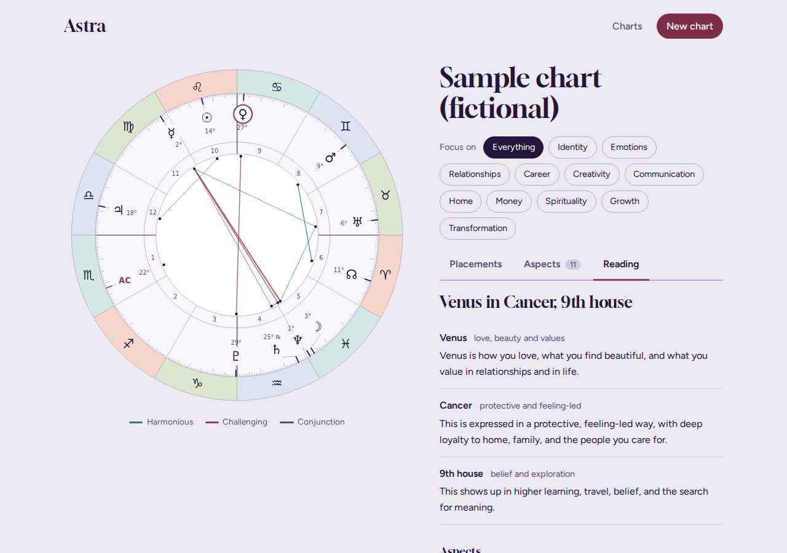
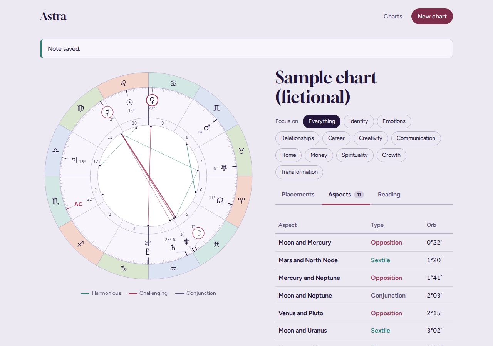
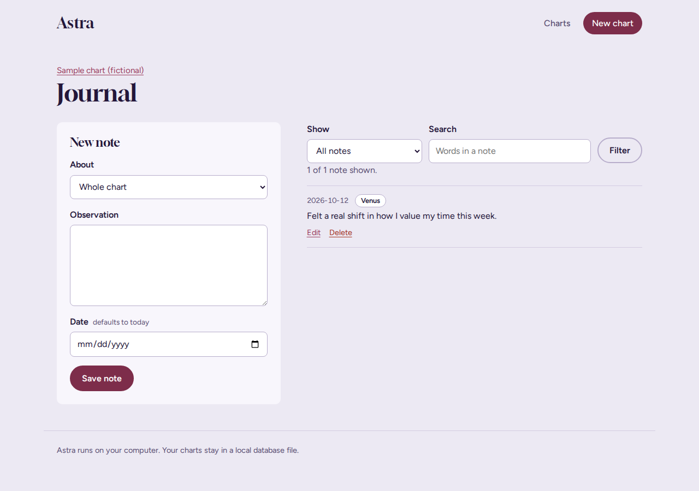

# Astra

Astra is a local web app for exploring astrology birth charts. Enter the placements from a chart you already have and Astra draws an interactive wheel, works out the houses and aspects, builds a written reading for every placement, and lets you keep a journal of observations attached to specific planets.

Everything runs on your own computer with Flask and SQLite. There are no accounts, no external services and no API keys.



## Features

**Chart wheel**
- SVG wheel drawn from scratch in JavaScript: zodiac band tinted by element, degree ticks, house numbers, and planets that are nudged apart when they crowd each other.
- Whole-sign houses calculated automatically from the Ascendant.
- Aspects (conjunction, sextile, square, trine, opposition) calculated with orbs and drawn inside the wheel, coloured by harmonious or challenging.
- Wheel, placements table and aspect list are linked: hover or focus one and the others respond.

**Readings**
- Select any body to get a reading built from three layers: what it represents, how its sign colours it, and where its house places it. Each aspect touching the body adds a sentence.
- Topic filters (Identity, Relationships, Career and more) dim everything not relevant to the topic you choose.
- Interpretations live in the database and are seeded from one content file, so the wording can be edited without touching any logic.

**Journal**
- Attach notes to a specific placement or to the whole chart, with a date.
- Edit, delete, filter by placement and search by words. Notes are shown on the reading itself and in a full journal page.

**Quality**
- Server-side validation with clear messages on every form.
- 50+ automated tests for the astrology maths, the interpretation engine, the journal and every route, run on each push by GitHub Actions.
- Keyboard accessible (tabs, wheel, table), responsive down to phone width, respects reduced-motion settings, and fonts are bundled so it works offline.

| 



 | 



 |

## Run it

You need Python 3.10 or newer.

```bash
git clone https://github.com/lelentandane/astra.git
cd astra

python -m venv .venv
# Windows:      .venv\Scripts\activate
# macOS/Linux:  source .venv/bin/activate

pip install -r requirements.txt
python run.py
```

Open http://127.0.0.1:5000 and choose "Explore a sample chart" to see everything straight away.

## Run the tests

```bash
python -m pytest
```

## How it works

**Positions.** Every placement is stored as a sign, degree and minute. `astro.py` converts that to an ecliptic longitude from 0 to 360. The house is `(planet sign - ascendant sign) mod 12 + 1`, which is the whole-sign system.

**Aspects.** For every pair of bodies, the shortest angular distance (0 to 180) is compared with each aspect angle. If the gap is inside the allowed orb, the aspect is recorded. The Ascendant and North Node use an orb of at most 3 degrees so they do not flood the chart. Results are sorted tightest first.

**The wheel.** `wheel.js` turns a longitude into a screen angle relative to the Ascendant's sign, which sits at the left edge, then builds the SVG as a string. The same function runs in the browser and in Node, which made it easy to check the geometry on its own. A relaxation pass pushes crowded planets apart while a small tick marks each true position.

**Readings.** `interpret.py` is a small rule-based engine: it looks up the body, sign, house and aspect pieces stored in SQLite, joins them in order, and collects topic tags from the body and the house. No AI service is involved, so results are deterministic and testable.

**Data model.** Charts own placements and notes (both cascade on delete). Interpretations and their topics are separate tables joined by id. All SQL lives in `repository.py` and every query is parameterised.

## Project structure

```
astra/
  __init__.py        App factory
  astro.py           Signs, bodies, longitude, houses, aspects, form validation
  content.py         Interpretation wording and topic tags
  interpret.py       Builds readings from the stored pieces
  journal.py         Note validation
  db.py              SQLite connection and startup seeding
  repository.py      All SQL queries
  routes.py          Pages and form handling
  schema.sql         Database tables
  templates/         Jinja pages
  static/css/        Stylesheet and design tokens
  static/js/         wheel.js (SVG wheel) and chart.js (tabs, filters, reading panel)
  static/fonts/      Gloock and Figtree (SIL Open Font License)
tests/               pytest suite
.github/workflows/   Continuous integration
run.py               Start the app
```

## Possible next steps

- Calculate positions from birth date, time and place with an ephemeris library instead of entering them by hand
- Transit tracking and chart comparison
- Export a chart and its notes as PDF
- Import and export charts as JSON

## Notes

The sample chart is fictional. Interpretation text is a starting point written for this project and is meant to be edited in `astra/content.py`.

## Licence

MIT. Bundled fonts are under the SIL Open Font License, see `astra/static/fonts`.
